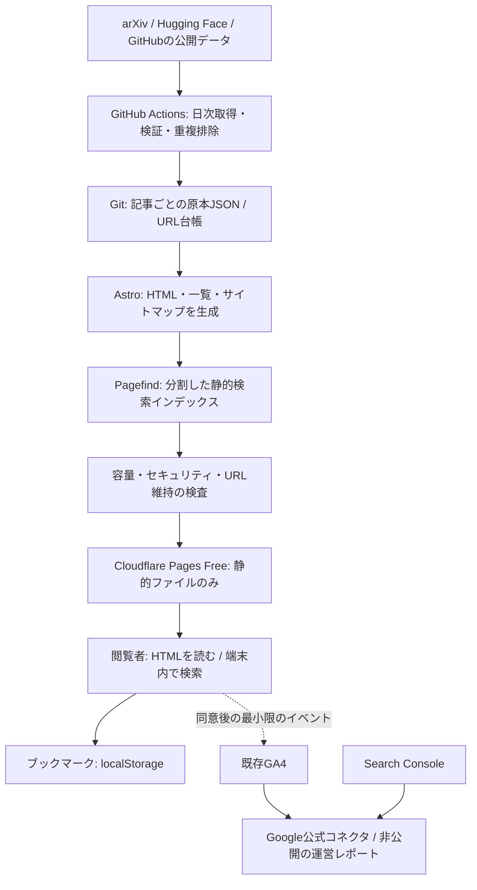

# MLinfo 無料運用アーキテクチャ案

作成日: 2026-10-22  
状態: 設計案。アプリの変更・ホスティング移行・アカウント設定は未実施。  
対象: 公開記事サイト、検索、ブラウザ内ブックマーク、個人用の運営分析。

## 1. 結論

**Pythonの日次収集 → Gitの原本データ → Astroの静的生成 → Cloudflare Pages Freeで配信**を推奨する。検索は**Pagefindをブラウザ内で実行**する。記事閲覧・検索・404にサーバー関数を使わない。

公開サイトにオンラインDB、SSR、ISR、APIサーバー、管理画面、ログイン、決済を設けない。原本と公開用データを分け、全記事JSONを訪問者に渡さない。記事URLは保持期間内で安定させ、取得対象から外れたことだけを理由に削除しない。通常記事は期限・件数による自動整理を認め、重要記事は別枠で保護する。

運営分析は公開サイトから分離し、既存GA4とSearch ConsoleをGoogle公式の無料コネクタでData Studio（旧Looker Studio）につなぐ。スマホ用の非公開レポートを第一候補とする。独自ダッシュボードへの自動連携は初期構成に含めない。

無料枠と脆弱性が存在しないと保証する設計ではない。**訪問者数に比例したサーバー処理をなくし、有限の上限は公開前に検出し、超過時は新規更新だけを止め、直前の正常なサイトを残す**設計である。規約変更・障害・アカウント停止まで防ぐものではない。

## 2. 現状で確認したことと未確定事項

| 項目 | 確認内容 |
|---|---|
| Vercel通知 | チームのFast Origin Transferが10.57GB / 10GBに到達 |
| 記事リクエスト | `/article/arxiv-2610.21591`が404、Cache MISS / Cold、ISR Function Invocationが168ms、応答後にISRキャッシュ更新 |
| 通信先 | 当該リクエストにExternal APIsの外向き通信なし |
| 記事保存 | `scripts/fetch_articles.py`は今回取得した記事で`articles.json`を上書き。通常時に過去記事をマージしない |
| 記事ルート | `generateStaticParams`が現データのIDを列挙し、見つからない記事は`notFound()` |
| 404 | 人気・新着の記事カード計6件を描画 |
| 検索 | `searchParams`を参照するサーバー検索。結果全件を描画し、上限・ページ分割なし |
| データ配信 | Client Componentへ記事モデルを渡す。カテゴリ・保存ページは大量のデータを渡す構成 |
| 秘密情報 | GitHubトークン・GroqキーはActions Secrets参照。公開値の有無を全履歴監査したわけではない |
| XSS候補 | JSON-LDへ外部データを`JSON.stringify`だけで直接挿入する箇所がある |

**10.57GBの寄与率、アクセス元がボットか、他のパスの応答サイズは未確定。** スクリーンショットは特定の時間帯のログであり、期間全体の原因を証明しない。キャッシュ更新後も全アクセスで関数が動く、とは判断しない。ログの288MBはレスポンスサイズではない。

## 3. 構成と責務



| 責務 | 採用 | 判断理由 |
|---|---|---|
| 取得・整形 | Python、標準Linux runnerのGitHub Actions | 既存スクリプトを再利用。閲覧数と取得回数を切り離す |
| 正式な保存場所 | Git内の1記事1JSON | 更新差分を確認・復元でき、常時稼働DBが不要 |
| 公開ページ | Astroの静的出力 | コンテンツ主体。記事原本のReactへのシリアライズや全ページのhydrationを避ける |
| 部分操作 | 小さな外部JS。必要時のみReact部品 | ブックマーク・検索以外にJSを必須にしない |
| 検索 | Pagefind extended、静的インデックス | 日本語分割を利用し、検索用サーバーを不要にする |
| 配信 | Cloudflare Pages Free | 関数を呼ばない静的リクエストは無料・無制限。ファイル数等の上限は別途管理 |
| 分析 | GA4 Standard / Search Console / Google公式無料レポート | 計測・認証を自作せず、既存データを活用 |
| API・AI要約 | 課金なしで利用できるAPIを収集・更新時に任意利用 | 支払い方法不要・超過時停止等を個別確認。必須依存にせず既存要約と原文抜粋へフォールバック |

Astro移行は費用・データ境界を単純にするための選択で、Next.jsが危険という判断ではない。Next.js静的エクスポートも可能だが、現在のサーバー検索、巨大なclient props、RSC出力、CSP対応を併せて整理する必要がある。最小限の緊急対処としてはNext.js上で`dynamicParams=false`・404軽量化・結果制限を先行できるが、最終構成は静的配信にそろえる。

## 4. 原本データの設計

### 4.1 配置

```text
content/
  articles/<source>/<year>/<safe-id>.json   # 公開可能な原本。公開ディレクトリにはコピーしない
  registry/urls.json                      # 公開済みpathと記事IDの対応・別名・状態
  editorial/<safe-id>.json                # 手作業の分類・既存日本語要約の上書き
schemas/article.schema.json               # 許可する型、文字数、URL等
scripts/                                  # 取得・検証・原本マージ・容量検査
web/src/                                  # 静的サイト
web/public/404.html                       # 最終的に軽量な404として出力
build/                                    # 使い捨ての派生物。Gitには保存しない
  dist/                                   # これだけを配信
  capacity-report.json
```

原本はタイトル・著者・要約・公開日・出典・タグ・リンク・出典の改訂情報など。PDF、論文全文、リポジトリのソース一式、画像、外部HTMLを保存・代理配信しない。収集元の許可範囲とライセンス情報に従い、出典へリンクする。

### 4.2 記事モデル例

```json
{
  "schema_version": 1,
  "id": "arxiv-2610.21591",
  "canonical_path": "/article/arxiv-2610.21591",
  "source": "arxiv",
  "source_id": "2610.21591",
  "source_version": "v1",
  "source_url": "https://arxiv.org/abs/2610.21591",
  "published_at": "2026-10-20T00:00:00Z",
  "source_updated_at": "2026-10-20T00:00:00Z",
  "first_seen_at": "2026-10-21T00:00:00Z",
  "content_updated_at": "2026-10-21T00:00:00Z",
  "title": "記事タイトル",
  "authors": ["著者名"],
  "abstract_text": "HTMLではないプレーンテキスト",
  "summary_ja": null,
  "category": "machine-learning",
  "tags": ["optimization"],
  "code_url": null,
  "publication_state": "published",
  "content_hash": "sha256-of-normalized-fields"
}
```

例の日時・本文は設計用。実在記事のメタデータを示すものではない。

- 内部ID、公開path、取得元IDを分離。出典のversion更新やカテゴリ変更でも公開URLを変えない。
- 原本は1記事のUTF-8 JSONとして最大32KiBを設計上の上限とする。タイトル500文字、著者20名、要約10,000文字等のフィールド上限も併用し、超過は隔離・記録する。
- 著者数等を表示都合で制限する場合は、省略したことを示す。日付等を推測で補わない。
- 保存用ファイル名は検証済みのsafe-idまたはハッシュから生成し、出典が返した文字列をファイルパスに直接使用しない。
- arXivとHugging Faceに同じ論文がある場合は出典IDで対応付ける。既存の別名URLは維持し、必要なものだけ静的リダイレクトを生成する。
- `last_seen`の変化だけで全原本を書き換えない。取得ログは別管理し、内容ハッシュが同じならファイル更新・ビルドを省く。
- `use_case_cache.json`は記事単位の既存要約へ統合し、肥大化する重複キャッシュとして残さない。

### 4.3 更新・欠損・削除

1. 固定した取得元APIから、ページ数・件数・時間を制限して収集する。
2. 収集結果をステージング領域で検証する。URL・本文・IDは信頼しない。
3. 既存原本へID単位でupsertする。今回取得されなかった記事はそのまま残す。
4. 一部取得失敗時はそのソースの既存データを保持し、失敗を報告する。空データで置き換えない。
5. 公開済みURL台帳と照合する。保持規則に基づく削除計画を別に生成し、計画にないURL減少ではデプロイを止める。
6. 撤回された論文は通常、出典の撤回状態を表示してURLを残す。権利・個人情報等の削除要求は別手順で本文・検索インデックス・キャッシュを除去する。
7. 削除時はGit履歴も公開履歴であることに注意する。秘密情報なら履歴処理だけでなく先に鍵の失効・再発行を行う。

保存量は記事数に比例して増える。それをブラウザへの転送量と切り離す設計であり、ファイル分割だけで保存量が減るわけではない。

### 4.4 通常記事の自動整理と重要記事の保護（ユーザー条件に合わせた改訂）

ここでの値は実装前の推奨初期値。記事ごとに`retention_class: normal | important`、手動保護の理由、選定日を追加する。

| 区分 | 保持規則 | 上限時の動作 |
|---|---|---|
| 通常記事 | 公開日から180日以内、かつ新しい順に最大3,000件 | 期限超過または件数超過で古い順に自動削除。容量警告時は期限内でも古い順に整理可能 |
| 重要記事 | 長期保持。初期保護枠500件 | 自動削除しない。枠に達したら新規昇格を保留し、既存の保護対象を手動で見直す |
| 重要候補 | 分類・実装の有無・用途適合・出典の反応等から候補化 | 人気だけで重要と断定せず、手動選定後に保護する |

重要記事は基礎・定番手法、製造業/材料開発への適合、実装・再現性、継続して参照される解説などを優先する。後から高評価になった記事も再評価可能にし、取得元のlikesやモデルの出力だけで自動保護しない。採用初期の自動処理は候補提示までとする。

整理処理は先に削除計画（記事ID・理由・推定削減数）を作り、重要記事・手動保護が含まれないことを検査してから原本の現行版と公開成果物から外す。記事HTML、一覧、サイトマップ、Pagefindを同じビルドで更新する。初回の既存記事の分類・大量整理はdry-runの件数を確認して導入する。新規分類APIの失敗を理由に既存の重要フラグを解除しない。

削除済みURLには共通の軽い静的404を返す。別記事やトップへ無関係にリダイレクトせず、記事ごとの動的404生成や個別墓標HTMLを増やさない。削除による検索流入・被リンク・利用者のブックマークの喪失は受け入れるトレードオフとして計測する。端末内の保存は記事の存在を保証しない旨を案内する。

これは**公開と原本の現行版からの削除**であり、Git履歴からの完全消去ではない。Git履歴の増加は保持件数だけでは止まらない。履歴容量も監視し、肥大化時に履歴の長期保存先や整理を別途検討する。自動force-pushによる履歴消去はしない。

### 4.5 無料APIを利用する条件

- 既存の公開情報取得APIに加え、無料の要約・分類APIも利用可能。ただし本番有効化前に、無料条件、商用利用可否、支払い方法の要否、超過時の挙動、入力の保存方針を確認する。
- 支払い登録や従量課金契約が必要なAPIは初期構成では使わない。無料試用期間のみ・クレジット消費後に自動課金されるAPIも使わない。
- 呼び出しは日次の収集/更新処理に閉じ、訪問・検索のたびには呼ばない。1日・1回あたりの回数、タイムアウト、最大再試行数を設定する。
- 入力ハッシュ・API/モデル版で結果をキャッシュし、同じ記事を毎日処理し直さない。既存要約は再利用する。
- 429や無料枠終了でその日の追加処理を止める。有料APIへの切替・追加購入・無限リトライは行わず、原文抜粋と既存データで公開する。
- APIの出力も未信頼テキストとして検証し、重要記事の保護解除、ファイルパス、shell、実行コード、任意URL取得の指示には使わない。

## 5. ページと検索の配信契約

| ページ | 配信データ | 初期上限 |
|---|---|---|
| トップ | 最近・注目の短いカード | 記事カード最大24件、本文・原本なし |
| カテゴリ / タグ | ビルド時にページ分割したカード | 1ページ24件。全記事配列をJSへ埋め込まない |
| 記事 | 当該記事のHTMLと関連カード | 関連最大3件。全原本・AIキャッシュを同梱しない |
| 検索 | 静的検索画面、遅延取得するPagefindデータ | 最初の20件だけ詳細情報を読む。追加は操作時 |
| 保存 | 端末に保存した小さなカード情報 | 全記事JSONを取得しない |
| 存在しないURL | 配信基盤の静的404 | 本文・スクリプト・検索索引を取得しない |

- `/article/<既存ID>`、`/category/<id>`、`/search?q=...`を可能な限り維持する。検索クエリはブラウザJSが読み、HTMLは全クエリ共通。
- `404.html`を必ず出力し、`/* → index.html 200`のSPAフォールバックは使わない。未知URLはHTTP 404を返す。
- `/search`はnoindex。検索語をHTMLとして描画しない。JS無効時はカテゴリ一覧を案内する。
- Pagefindは記事タイトル・短い要約・分類・タグを中心に索引化し、ナビ・フッター・一覧ページを対象外にする。本文全文検索を入れるかは容量・精度の評価後に決める。
- `lang=ja`とextended版を使用し、日本語・英語の検索例を受け入れテストに含める。日本語であることだけを理由に全件索引を一括取得しない。
- 検索初期化は検索画面でのみ実行。入力は300ms程度でまとめ、古い検索結果を画面に反映しない。結果データ取得は最大4件並行、20件単位。
- 自動的な全リンクprefetch、全件データ取得、定期ポーリング、外部画像プロキシを設けない。
- ブックマークは`id,title,path,source,published_at,saved_at`程度だけを保存。現行のID配列は互換読込し、表示情報がない場合は既存URLへのリンクとして残す。全件取得で補完しない。
- ログイン・端末間同期は初期対象外。必要なら利用者が操作するJSONエクスポート/インポートを用意する。

### キャッシュとバージョン整合性

HTMLはPages標準のキャッシュ・再検証を基準とし、長いブラウザimmutableキャッシュを設定しない。CSS/JSは内容ハッシュ付きのファイル名にする。Pagefind出力は`/search-assets/<build-id>/`へまとめ、検索画面と同じビルドのディレクトリを参照する。名前の変わらない検索manifestを1年キャッシュしない。

検索中にデプロイされ旧索引が取得できなくなった場合は、検索を止め「更新されました。再読み込みしてください」と表示する。無限再試行や全索引の再取得はしない。旧索引を何世代も保持する場合はファイル数に加算して容量検査する。Service Workerは初期導入しない。

## 6. 無料で運用する条件と容量予算

### サービスの実際の上限（2026-10-22に公式資料確認）

| サービス | 公式に確認できた条件 | 設計への影響 |
|---|---|---|
| Cloudflare Pages Free | 関数を呼ばない静的リクエストは無料・無制限。静的帯域も無制限と案内 | 訪問者数に比例するSSR/ISRコストをなくす。利用規約・障害・将来変更の免除ではない |
| Pagesファイル数 | 1サイト20,000ファイル | HTMLだけでなく検索fragment、CSS/JS、別名ページ等をすべて数える |
| Pages単一ファイル | 最大25MiB | 巨大JSON・PDFを配信しない |
| Pagesビルド | Freeは月500、同時1、20分でタイムアウト | 原則1日1回。不要なpushでビルドしない |
| GitHub Actions | 公開リポジトリの標準runnerは実行時間無料。大型runnerは対象外 | 公開可能データだけで運用。Artifact/Cache等の保存枠は別に管理 |
| Vercel Hobby | 非商用個人利用に限定。広告掲載等は商用扱い | 収益化を見据える最終配信先には採用しない |
| 分析 | Data Studioの無料版・Google製無料コネクタを使用可能 | GA4のクォータは残る。非公式有料コネクタやBigQueryは導入しない |

### 独自に設定する安全予算

以下はサービスの保証値ではなく、初期実装の公開判定値。実測後に余裕を残して調整する。

| 指標 | 初期方針 |
|---|---|
| 配信時の関数実行 | 0。`functions/`、`_worker.js`、SSR adapterの混入で検査失敗 |
| 公開ファイル数 | 12,000で警告、16,000以上で新規デプロイ停止（公式上限20,000より前） |
| 最大ファイル | 20MiB以上で停止（公式上限25MiBより前） |
| 静的成果物合計 | 500MiBを独自の初期上限とする。超過は公開を止めて原因調査 |
| 原本データ | 合計100MiBで警告、200MiBで新規追加を見直す。通常記事は承認済みの保持規則で整理。Git履歴の容量は別途監視 |
| 月間ビルド | 通常約30〜31回。緊急修正等を含め100回以内を運用目安とする |
| ビルド所要時間 | 10分で警告、15分を継続して超える場合は新規記事追加を止めて対策 |
| 404 HTML | gzip換算10KiB以内を目標。取得元API・関数呼出しは0 |
| 記事 / 一覧HTML | gzip換算各60KiB / 100KiB以内を目標 |
| 共通JS | gzip換算100KiB以内を目標。検索モジュール・外部計測を別測定 |
| 検索初回ロード | 冷えたキャッシュで代表クエリが2MiB以内を初期目標にする。実測前の保証はしない |
| 収集 | 1日1回、タイムアウト・ページ数・再試行上限を設定。内容に差分がなければデプロイしない |

ファイル数はおおむね`記事HTML + 別名/一覧/固定ページ + Pagefind fragment/索引 + JS/CSS等`。**1記事1JSONにしても、その原本を配信しなければ原本のファイル数はPagesの20,000に加算されない。** ただしPagefindにも記事数に応じた出力があるため、20,000記事を配信できるという意味ではない。

容量試験は現件数・5,000件・8,000件で行い、合計ファイル数・圧縮サイズ・ビルド時間を記録する。5,000件は試験点であり、収容保証数・保存期限ではない。新規20記事/日でも年7,300件増えるため、無制限蓄積を永久に無料で続けられるとは約束しない。

12,000ファイル警告時点で、保護対象以外の通常記事を古い順に削除する計画を生成し、検索索引等も再生成して容量を再計測する。重要記事は自動削除しない。整理後も16,000以上ならデプロイを開始せず、現在の公開版を維持して新規公開を保留する。ホストを多数作って上限を迂回する運用を前提にしない。

無料プランのみを選び、有料AI、Workers Paid、D1、R2、KV、Analytics 360、Data Studio Pro、有料コネクタを有効化しない。GitHubは標準runnerだけを使用し、Artifactを長期バックアップにせず、課金対象の利用・保存を止める予算設定も確認する。独自ドメイン取得は無料前提に含めず、当面は`pages.dev`を利用可能とする。

### 意図しない課金を避ける導入条件（追加確認）

- Pages Freeの静的配信だけを利用し、クレジットカード等の支払い方法を登録する手順を設けない。Pagesは公式にカード不要で開始できると案内されている。
- 新規課金に同意するcheckout、Workers Paid、R2 subscription、Images、Stream、Cache Reserve、有料ドメイン購入・更新を今回の導入手順に含めない。
- 既存アカウントを使う場合は、サイトのFree表示だけで判断せず、Billingのアカウント全体のSubscriptionsと支払い設定も確認する。ドメインのFreeプランとWorkers等のアカウント契約は別である。
- 「無料枠がある従量課金サービス」は採用しない。R2は無料使用量が含まれていてもsubscriptionの申込みが必要で、超過分の請求があり得る。
- 予算アラートを課金停止スイッチとして扱わない。基本対策は課金対象を契約・有効化しないことと、関数や有料ストレージへの依存を成果物検査で排除することである。
- 支払い方法が未登録であっても、既に契約済みの有料サービスの債務までなくなるとは考えない。アカウントをまだ確認していないため、現在のユーザーの契約状態は未確認。

## 7. ビルド・配信パイプライン

1. 日次の収集job。API呼び出しは収集時だけ。公開ページからは呼ばない。
2. 既存原本とマージし、変更ファイルのみbotがcommitする。書込み権限はこのjobだけに付与する。
3. `content/**`または公開サイトのソース変更でPagesがビルド。収集jobと別のジョブとして扱い、CIの再帰実行を起こさない。
4. 固定バージョンとlockfileでインストール。原本検証 → Astroビルド → Pagefind → 容量・URL・安全検査の順。
5. 全検査成功後だけ静的成果物をデプロイ。失敗時は直前の正常デプロイを維持する。
6. ビルド結果に件数・追加/更新数・全ファイル数・最大ファイル・圧縮サイズ・所要時間を記録する。
7. 公開後は少数の代表URLをGETし、HTTP状態・ヘッダー・検索の動作を確認する。負荷試験は本番に実施しない。

収集内容の差分と、公開に不要なランキング数値・タイムスタンプの更新を区別する。更新のたびに全記事を書き直したり、取得した時刻だけでビルドを発火させたりしない。Pagesの自動ビルド対象は本番ブランチに絞り、スケジュール・手動実行の重複はconcurrency制御する。ジョブは最大30分、取得先ごとの低頻度・バックオフと429対応を設ける。

## 8. セキュリティ設計

### 外部データの境界

- 収集対象は固定した提供元・HTTPS APIに限定。記事内のURLをたどってfetchしない。
- 取得でリダイレクトを許す場合は各遷移先を検査し、localhost・私有IP・メタデータサービス等へ転送しない。APIレスポンスにはサイズ・タイムアウト上限を設ける。
- XMLはdefusedxml等で扱い、スキーマ・文字数・型・文字コードを検証。不正レコードを隔離し、他の正常記事は保持する。
- 外部本文をHTML/MDX/JSとして扱わない。テキストとして自動エスケープして描画し、外部入力由来の`set:html`や`dangerouslySetInnerHTML`を使わない。
- JSON-LDは`<`を`\u003c`等に置換し、script終了タグを作れないようにする。`</script>`を含むデータで検証する。
- リンクは用途別のHTTPSホスト許可リストとURLパーサーで検証。`javascript:`、`data:`、資格情報付きURLを拒否。表示上必要な未許可URLはリンクにせずテキストとして扱う。
- タグ・ID・カテゴリを任意のファイルパス、shell、動的importへ渡さない。

### ブラウザ

- CSPは`unsafe-inline`と一般的な`unsafe-eval`を許可しない方針。初期化JSを外部ファイルへ分離する。
- Astroが必要なインラインscript/styleとJSON-LDはビルド時のハッシュを生成。ページごとのmeta CSPを使う場合はhead先頭に置き、metaでは効かない`frame-ancestors`等は配信HTTPヘッダーで設定する。ハッシュ生成後にHTMLを書き換えない。
- PagefindのWasmが必要とする`script-src 'wasm-unsafe-eval'`だけを限定的に許可する。これは一般JSの`unsafe-eval`とは区別する。
- Pagefind workerは`worker-src 'self' blob:`の必要性を採用バージョンで検証。不要な許可は入れない。検索初期化JSを外部化し、動作のためにCSPを全面解除しない。
- `object-src 'none'`、`base-uri 'none'`、`frame-ancestors 'none'`、`X-Content-Type-Options: nosniff`、`X-Frame-Options: DENY`、適切なReferrer-Policy・Permissions-Policyを設定。
- GA4が必要な送信先だけを限定許可。外部CDNからUIライブラリを読み込まず、CSS/JS/フォントは原則同一オリジン。
- `_headers`はCloudflare Pagesに合わせて用意する。現在の`next.config.ts`のheaders設定が移行先で自動的に適用されるとは考えない。
- 新しいタブの外部リンクは`noopener noreferrer`。検索ハイライトのHTMLを無条件でinnerHTMLへ渡さない。
- localStorageのデータも信頼せず、型・件数・URLを検査。秘密情報・APIキーを保存しない。

### CI・アカウント・秘密情報

- 外部APIの鍵は必要最小限だけをCI Secretsへ置く。Groq等の既存APIも、現在の契約・超過課金・無料上限を確認してから任意で再利用する。確認前は呼び出さない。不要な鍵の削除・失効は移行時に対象を確認して実施する。
- 読取り権限を標準にし、原本commitのjobだけ`contents: write`。外部APIへ書込みトークンを送らない。checkoutの永続credentialを無効化し、書込みは必要なstepだけに限定する。
- 外部PRのコードを秘密情報付きで実行しない。`pull_request_target`で未信頼コードをcheckoutしない。PRのpreviewに秘密情報を渡さない。
- ActionsはコミットSHAで固定。npm/Pythonの依存をlockし、更新PR・脆弱性検査を継続。依存インストール時には秘密情報を渡さない。
- 公開成果物はallowlistで配布し、`.env`・`.git`・原本ディレクトリ・CIログ・秘密鍵・社内メモを入れない。公開リポジトリに置く原本は最初から公開可能情報に限る。
- GitHub・Cloudflare・GoogleにMFA / passkey、最小権限、復旧手段を設定する。会員情報や管理用のAPIは公開サイトに置かない。
- 脆弱性ゼロを宣言しない。既知の重大な問題の解消、依存更新、XSS・ヘッダー・秘密漏えい検査を公開条件にする。

## 9. スマホで見る運営分析

初期は**Google公式の無料Data Studio（旧Looker Studio）レポート**を所有者だけに共有し、スマホのホーム画面から開く。GA4 StandardとSearch Consoleの公式無料コネクタを使い、有料の外部コネクタ・独自サーバー・認証token保存を避ける。

| 目的 | 指標と注意点 |
|---|---|
| 成長 | 日別/週別/月別アクティブユーザー、セッション、PV。期間UUを日別UUの合計として出さない |
| 継続利用 | エンゲージメント率、再訪傾向。利用可能なGA4指標の定義に従う |
| 記事価値 | 記事別閲覧、読了相当のイベント、保存、外部実装リンクのクリック |
| 集客 | 流入元、検索クリック・表示回数、国/端末。GA4とSearch Consoleの集計条件をそろえる |
| 改善 | 検索実行・結果0件・404。検索語そのものは初期送信しない |
| 収益化の見込み | 流入の成長、再訪、実装リンクのクリック率。実収益と将来推計を区別する |
| 技術健全性 | デプロイ結果、静的成果物の容量、更新の遅延。GA4だけで全ボット/HTTPアクセスを計測できるとは考えない |

既存GA4プロパティを維持し、ホスト移行日を記録する。新旧サイトの二重計測を防ぐ。記事IDと許可したイベント名だけを送り、メール・IP・氏名・自由入力・認証情報を送らない。queryを含むURLの自動収集も点検し、`page_location`・`page_referrer`・リンク先の不要なquery/fragmentを除去する。検索ページは汎用タイトルとし、計測用タイトルに入力内容を埋め込まない。

適用地域と運用方針に応じた同意制御を実装し、必要な同意前に解析scriptを読み込まない。バナーを表示するだけでは制御とみなさない。プライバシーポリシーは実際の送信項目に合わせる。

Google側のクォータ・集計遅延・しきい値は残る。自動更新は高頻度にせず、日次/前日までを基本とし、未取得や遅延は0と表示しない。公開URLや公開GitHubへ分析データをコピーしない。レポートはリンクを知る全員へ公開せず、所有者に限定する。

Vercelの過去使用量は移行前の比較資料として手動保存する。Vercelの有料内訳取得や非公開APIスクレイピングを初期設計に組み込まない。独自PWAが必要になった場合はCSVを端末内で読む方式を先行させ、Googleの認証データを静的HTMLへ埋め込まない。

## 10. 移行手順と公開判定

### 第1段階: 原本を守り、現状を測る

- 現行JSONを記事単位へ変換し、URL台帳・重複対応表・件数を作る。
- Gitの過去履歴から公開済み記事とURLを調べ、復元できる原本は回収する。Gitに残っていない本文の復元は保証しない。
- 代表ページと404のサイズ・現行ログ・計測設定を保存する。過去10.57GBの寄与率は確定していないと明記する。

### 第2段階: 静的版を作る

- Astroで同じURLのページ、ページ分割一覧、静的404を出力する。
- Pagefind検索・小さなブックマーク処理を実装。外部APIとサーバー処理を外す。
- 既存日本語要約と原文抜粋を基本とする。条件を確認できた無料APIは日次更新時に任意で使用でき、上限・障害時は要約をスキップする。日本語自動要約を公開の必須条件にしない。
- 容量・URL維持・検索品質・安全対策の検査を組み込む。

### 第3段階: 配信を切り替える

- Cloudflareの無料アカウント・Pagesの本番ブランチを設定。無料設定と有料機能の無効を確認する。
- 一時URLで検証後に本番URLを決定する。`mlinfo.vercel.app`はCloudflareへ移管できないため、新ホストへ変わる。
- 独自ドメインが既にあれば利用を検討。なければ`pages.dev`を使い、ドメイン取得費用を発生させない。
- 旧Vercel URLは利用可能なら静的なホスト単位リダイレクトを設定し、動的アプリ配信・日次再デプロイを止める。旧環境の停止やリダイレクトにもVercel側の条件が残り、上限超過中の転送を保証できない。
- canonical・sitemap・内部リンク・Search Console・GA4を変更。旧URLや検索順位が即時移るとは考えない。

### 第4段階: 1〜2週間の確認

- 重要記事と保持期間内の通常記事が残り、削除計画外の欠落がなく、未知・削除済みURLが関数なしで404になることを確認。
- GA4とSearch Consoleのデータが蓄積されること、404イベントが減るか、検索/保存が使われるかを確認。
- 容量増加の実測から次に見直す時期を決める。有料サービスへの自動移行はしない。

### 受け入れ条件

1. サーバー関数・ISR・外部API呼出しが閲覧/検索/404経路に存在しない。
2. 旧記事IDとURLの台帳比較に合格。取得結果から消えただけでページを消さず、期限・件数・容量による削除計画だけを適用する。重要記事は自動削除しない。
3. 検索語変更時に新たなサーバーレンダリングを起こさず、20件ずつ表示する。
4. 未知URLでHTTP404を返し、トップを200で返す代替挙動がない。
5. 外部テキストのHTMLタグ・script終了文字列・危険URLが実行されない。
6. CSP・MIME・frame制限を本番レスポンスで確認。Pagefind・保存・GA4同意制御がCSPを解除せず動く。
7. 原本・秘密情報・私有分析データが公開成果物に入らない。
8. 公式上限と独自予算を満たす。最大データ試験でも実測を残し、超過時は公開を止める。
9. CI失敗で正常サイトを置換せず、Git原本と前の正常デプロイから復元できる。
10. 有料API呼出し0、有料ストレージ/DB/分析コネクタ0。無料APIは許可リスト・回数上限・課金条件の確認を満たす。デモ値を実測として表示しない。

## 11. 採用しない案

| 案 | 今回採用しない理由 |
|---|---|
| 巨大JSONをそのまま保持して全件配信 | 保存の改善と配信の改善を切り分けられず、閲覧・検索・保存画面が重い |
| 無料DB + 閲覧ごとのAPI | 無料の読取り/CPU枠が訪問者やボットで消費される。不要な認証・入力経路が増える |
| Vercelに動的アプリを残し手前だけCDN化 | origin依存とキャッシュミス時の関数・転送が残る |
| 収集結果から外れた記事を無条件削除 | 意図しないURL消失を招く。代わりに期限・件数・重要記事保護を明示した規則で整理し、404は静的配信する |
| 無料AIを公開の必須依存にする | 無料API自体は利用可。ただし無料枠終了・上限・障害で公開を止めず、有料へ切り替えない |
| GitHub Pagesを収益サイトの恒久配信先とする | 商用用途の制約等を含む適合性の検討が必要で、今回の主案にはしない |
| 有料観測機能でしか取れないデータを必須にする | ユーザーの無料運用条件に反する |

## 12. 公式資料

参照日: 2026-10-22。利用条件は本番設定時にも再確認する。

- Cloudflare Pages 料金・静的リクエスト: https://developers.cloudflare.com/pages/functions/pricing/
- Cloudflare Pages 製品・無料帯域の案内: https://www.cloudflare.com/products/pages/
- Cloudflare Pages 上限: https://developers.cloudflare.com/pages/platform/limits/
- Cloudflare Pages 404・キャッシュ: https://developers.cloudflare.com/pages/configuration/serving-pages/
- Cloudflare Pages ヘッダー: https://developers.cloudflare.com/pages/configuration/headers/
- GitHub Actions 課金: https://docs.github.com/en/billing/concepts/product-billing/github-actions
- Vercel Hobby 商用条件: https://vercel.com/docs/limits/fair-use-guidelines
- Pagefind 日本語: https://pagefind.app/docs/multilingual/
- Pagefind extended: https://pagefind.app/docs/installation/
- Pagefind CSP/Wasm: https://pagefind.app/docs/hosting/
- Astro 静的生成・CSP設定: https://docs.astro.build/en/reference/configuration-reference/
- Data Studio 無料版: https://docs.cloud.google.com/data-studio/welcome
- Google公式コネクタ: https://cloud.google.com/looker/docs/studio/about-data-sources
- GA4コネクタ・権限・quota: https://cloud.google.com/looker/docs/studio/connect-to-google-analytics
- GA4 Data API quota: https://developers.google.com/analytics/devguides/reporting/data/v1/quotas

- Pages カード不要の案内: https://www.cloudflare.com/products/pages/
- Cloudflare 請求とプラン/サブスクリプション: https://developers.cloudflare.com/billing/understand/faq/
- R2 subscriptionと請求: https://developers.cloudflare.com/r2/get-started/
